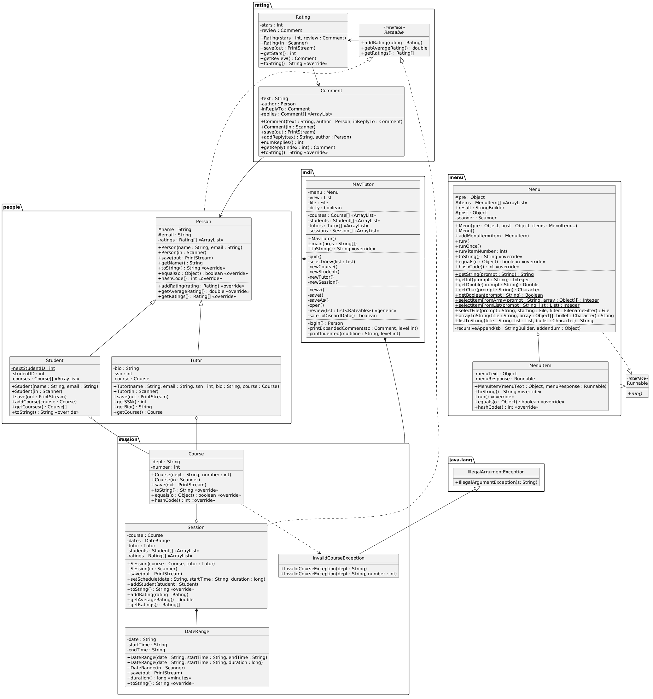

# MavTutor 🎓

A multi-package, object-oriented scheduling and session management platform written in Java. MavTutor enables tutors and students to connect, organize learning sessions, leave ratings/reviews, and collaborate effectively.

---

## ✨ Features

* **Session Management:** Connects tutors offering specific courses with students seeking academic support.
* **Rating & Review System:** Allows participants to rate tutors, students, and individual sessions.
* **Interactive Comments:** Supports multi-threaded discussion comments on reviews for clarification and feedback.
* **CLI Interface:** Clean menu-driven interface (`menu` / `mdi` packages) for easy navigation.

---

## 🏗️ System Architecture & Design

MavTutor is built using a modular architecture organized into dedicated Java packages:

* `people`: Manages `Person`, `Tutor`, and `Student` entities using OOP inheritance.
* `session`: Handles scheduling, course logic, and time ranges (`DateRange`).
* `rating`: Implements interfaces (`Rateable`) and review systems (`Rating`, `Comment`).
* `menu` & `mdi`: Handles user input and menu navigation logic.

---

## 🚀 How to Run

### Option 1: VS Code (Recommended)
1. Open `src/mdi/MavTutor.java`.
2. Click the **Run** / **Play** button directly above `public static void main(String[] args)`.

### Option 2: Command Line Terminal

1. **Navigate to the source directory:**
   ```bash
   cd src

## ✎ MavTutor PlantUML Project Diagram

